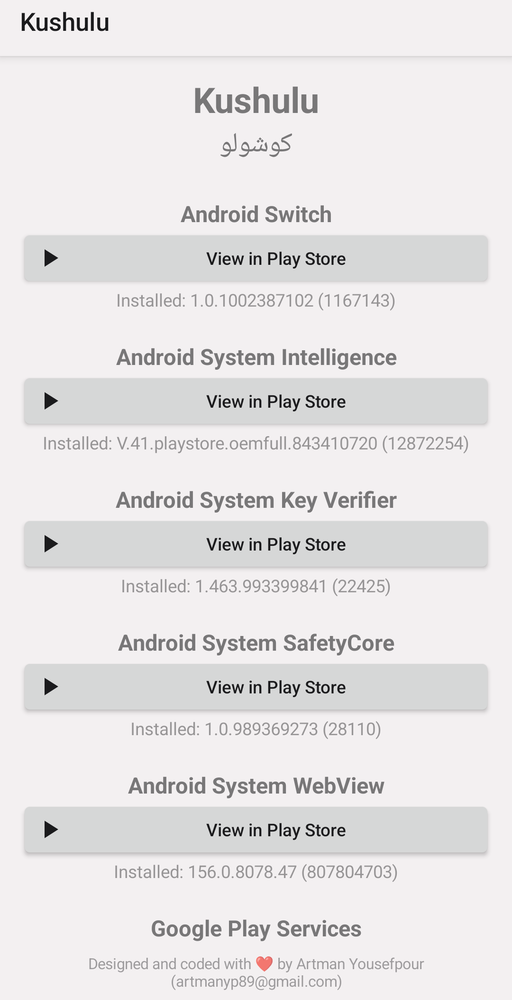
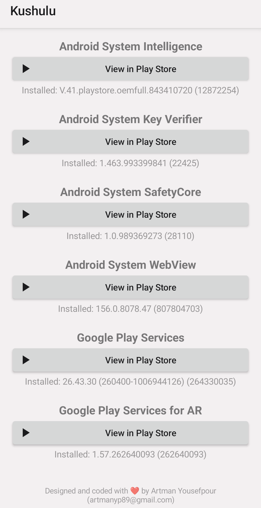
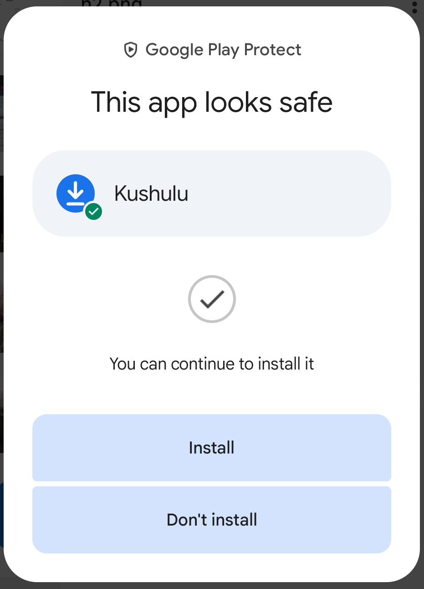

<p align="center">
  <a href="README.md"></a>
  <br>
  <a href="README.md">English</a>
</p>

<div dir="rtl">

# کوشولو (Kushulu)

یک اپلیکیشن کوچک با یک صفحهٔ اصلی: فهرستی از اپ‌های سیستمی گوگل که Play Store معمولی اغلب آن‌ها را به‌عنوان به‌روزرسانی نشان نمی‌دهد (Google Play services، Android System WebView، SafetyCore، Key Verifier، System Intelligence، Android Switch و Google Play Services for AR)، به ترتیب حروف الفبا. هر مورد یک دکمهٔ **View in Play Store** دارد که صفحهٔ همان اپ را در Play Store باز می‌کند، جایی که اگر به‌روزرسانی وجود داشته باشد دکمهٔ Update دیده می‌شود، و زیر آن نسخهٔ نصب‌شده نمایش داده می‌شود (یا «Not installed»). روی گوشی، تبلت، تلویزیون و ساعت کار می‌کند و از تم و ظاهر خود دستگاه پیروی می‌کند (روشن/تیره و رنگ‌های سیستم، هر جا اندروید فراهم کند). خط کپی‌رایت همیشه در فوتر ثابت می‌ماند.

## تصاویر

**صفحهٔ اصلی** (بالای فهرست، و سپس پایین فهرست همراه با فوتر کپی‌رایت):

<p align="center">
  
  &nbsp;&nbsp;
  
</p>

**Google Play Protect** هنگام نصب برنامه پیام «This app looks safe» را نشان می‌دهد:

<p align="center">
  
</p>

## مشخصات پروژه

شناسهٔ بسته `com.kushulu.app`، نام برنامه «Kushulu» (روی دستگاه‌هایی که زبانشان فارسی است «کوشولو» نمایش داده می‌شود).

- **AGP:** 9.5.1
- **Gradle wrapper:** 9.9.0
- **Android Studio (لازم برای ساخت):** آخرین نسخهٔ پایدار، نه Canary/Beta/RC — در حال حاضر 2026.2.2
- **Android Studio (آزمایش‌شده با):** 2026.2.2 که JetBrains Runtime (JBR) نسخهٔ **25** را همراه دارد
- **Java:** سطح سورس و تارگت 17 (جدیدترین LTS که اندروید رسماً پشتیبانی می‌کند)؛ خود Gradle روی **JDK 25** اجرا می‌شود که همان JBR همراه Android Studio است و در `gradle/gradle-daemon-jvm.properties` ثابت شده است
- **وابستگی‌ها:** هیچ (فقط ویوهای استاندارد پلتفرم، بدون AndroidX)، پس محدودیت minSdk از طرف کتابخانه‌ها وجود ندارد
- **minSdk:** 21 (اندروید 5.0 Lollipop، قدیمی‌ترین سطحی که AGP پشتیبانی می‌کند)
- **targetSdk / compileSdk:** 37 (بالاترین سطحی که AGP 9.5 پشتیبانی می‌کند)
- **Build Tools:** 37.0.0
- **نسخه:** `versionName` / `versionCode` در `app/build.gradle` (سه‌بخشی `x.y.z`)

> Android Studio در اولین Sync، اگر Build Tools 37.0.0 نصب نباشد، از شما می‌خواهد آن را از SDK Manager دانلود کند. اگر پیام «Undefined java.home ... #GRADLE_LOCAL_JAVA_HOME» را دیدید، پروژه را ببندید، پوشهٔ `.idea/` و فایل `.gradle/config.properties` را حذف کنید و دوباره باز کنید؛ آن‌وقت در Settings → Build Tools → Gradle باید **Daemon JVM criteria** نمایش داده شود.

## ساخت (Build)

1. آخرین نسخهٔ **پایدار** [Android Studio](https://developer.android.com/studio) را نصب کنید.
2. این پوشه را به‌عنوان پروژه باز کنید (File → Open). Android Studio در اولین بار Gradle wrapper را می‌سازد و خودکار Sync می‌کند.
3. برنامه را روی دستگاه یا شبیه‌ساز اجرا کنید، یا از Build → Generate Signed Bundle / APK → APK استفاده کنید (یا برای یک APK دیباگِ امضانشده از `Build > Build APK(s)`).
4. فایل APK خروجی در `app/build/outputs/apk/` قرار می‌گیرد.

از ترمینال، بعد از ساخته شدن wrapper: `./gradlew assembleRelease` (با JDK 25 در `JAVA_HOME`، مثلاً پوشهٔ `jbr` داخل مسیر نصب Android Studio).

## ساخت با GitHub Actions

فایل `.github/workflows/build.yml` برنامه را با هر push به `main`، با pull request، با اجرای دستی (Actions → Build APK → Run workflow) و با تگ‌های `v*` می‌سازد. نسخهٔ Gradle را از `gradle/wrapper/gradle-wrapper.properties` و JDK را از `gradle/gradle-daemon-jvm.properties` می‌خواند، پس همین دو فایل تنها منبع حقیقت می‌مانند (روی runner نیازی به Android Studio نیست). **پیشنهاد:** Gradle wrapper‌ای را که Android Studio روی سیستم شما ساخته (`gradlew`، `gradlew.bat` و `gradle/wrapper/gradle-wrapper.jar`) commit کنید؛ آن‌وقت workflow دقیقاً همان Gradle‌ای را اجرا می‌کند که Android Studio استفاده می‌کند.

- **دانلود:** وارد اجرای workflow شوید → Artifacts → `Kushulu-apks`.
- **APK دیباگ** (`Kushulu-debug.apk`): همیشه ساخته می‌شود و مستقیم روی هر دستگاهی نصب می‌شود.
- **APK ریلیز** (`Kushulu-release.apk`): فقط وقتی ساخته و امضا می‌شود که secretهای امضای زیر تعریف شده باشند؛ APK ریلیزِ امضانشده قابل نصب نیست، برای همین در غیر این صورت ساخته نمی‌شود.
- **صفحهٔ Release:** push کردن تگی مثل `v1.0.0` فایل‌های APK را به یک GitHub Release هم پیوست می‌کند.

برای فعال کردن ساخت ریلیز امضاشده، یک بار keystore بسازید و چهار secret در مخزن اضافه کنید (Settings → Secrets and variables → Actions):

```
keytool -genkeypair -v -keystore kushulu.jks -alias kushulu -keyalg RSA -keysize 2048 -validity 10000
base64 -w0 kushulu.jks        # paste the output into KEYSTORE_BASE64
```

| Secret | مقدار |
|---|---|
| `KEYSTORE_BASE64` | متن base64 فایل `kushulu.jks` |
| `KEYSTORE_PASSWORD` | رمز keystore |
| `KEY_ALIAS` | `kushulu` (یا aliasی که انتخاب کرده‌اید) |
| `KEY_PASSWORD` | رمز کلید |

فایل `kushulu.jks` را جای امنی نگه دارید و هرگز commit نکنید (`.gitignore` فایل‌های `*.jks` را از قبل مسدود کرده است). برای همهٔ نسخه‌ها از یک کلید استفاده کنید، وگرنه اندروید اجازهٔ به‌روزرسانی نسخهٔ نصب‌شده را نمی‌دهد.

## نصب روی دستگاه

- گوشی/تبلت/تلویزیون/ساعت با فعال بودن دیباگ: `adb install app-release.apk`.
- برنامه هم یک آیکن لانچر معمولی و هم یک ورودی لانچر Leanback (اندروید تی‌وی) با بنر ثبت می‌کند، پس در صفحهٔ اصلی تلویزیون هم دیده می‌شود.
- خودرو: Android Automotive OS ممکن است APK را بپذیرد، اما گوگل فقط دسته‌های مشخصی از اپ‌ها را آنجا مجاز می‌داند، و Android Auto آن را اجرا نمی‌کند.

## شخصی‌سازی

- **فهرست اپ‌ها:** نام‌ها و شناسهٔ بسته‌ها بالای فایل `app/src/main/java/com/kushulu/app/MainActivity.java` هستند؛ فهرست خودکار مرتب می‌شود. برای هر بستهٔ جدید یک خط `<package android:name="..."/>` به بخش `<queries>` در `AndroidManifest.xml` اضافه کنید (اندروید 11 به بالا اپ‌های دیگر را پنهان می‌کند و در غیر این صورت نسخهٔ نصب‌شده نمایش داده نمی‌شود).
- **فوتر کپی‌رایت:** `res/values/strings.xml` ← `copyright`. این خط باید در فوتر بماند.

## نحوهٔ باز شدن لینک‌ها

هر دکمه یک لینک ساده به شکل `https://play.google.com/store/apps/details?id=<package>` باز می‌کند. اگر Play Store نصب باشد همان آن را می‌گیرد، وگرنه مرورگر دستگاه باز می‌کند. هیچ بررسی‌ای برای وجود Play Store انجام نمی‌شود.

## آیکن‌ها

آیکن (یک فلش دانلود روی زمینهٔ آبی) یک vector drawable است: روی اندروید 8 به بالا adaptive، و روی اندروید 5 تا 7 یک آیکن لایه‌ای ساده. هر وقت خواستید می‌توانید با ابزار Image Asset در Android Studio (راست‌کلیک روی `res` ← New ← Image Asset) آن را عوض کنید؛ فقط ظاهری است.

</div>
