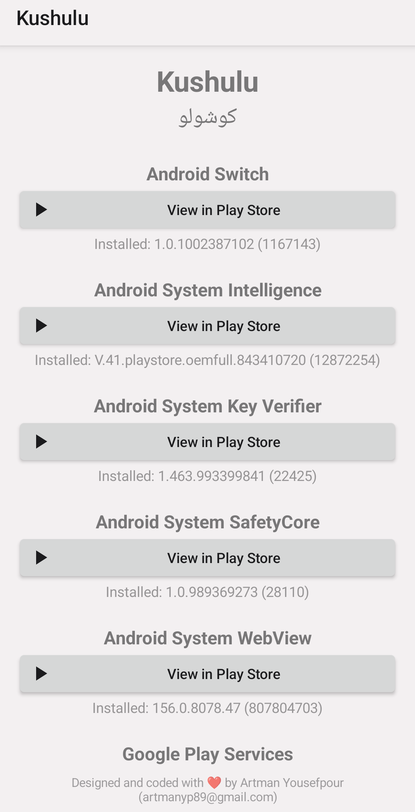
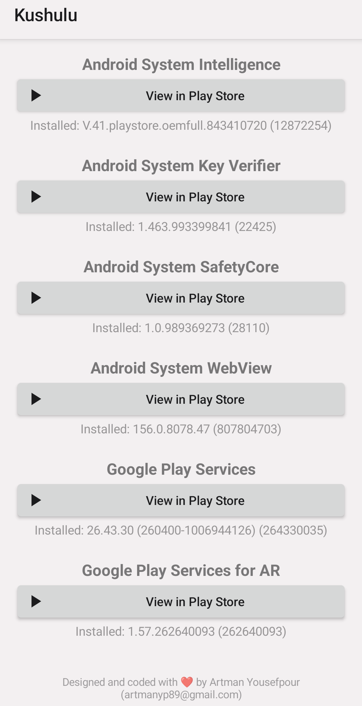
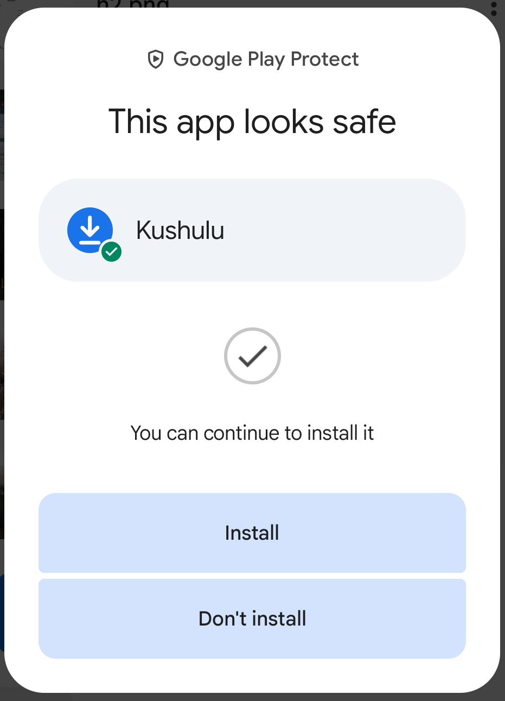

<p align="center">
  <a href="README.fa.md"></a>
  <br>
  <a href="README.fa.md">مطالعه به فارسی</a>
</p>

# Kushulu (کوشولو)

One small app, one home page: it lists Google's system apps that the normal
Play Store often doesn't offer as updates (Play services, Android System
WebView, SafetyCore, Key Verifier, System Intelligence, Android Switch,
Google Play Services for AR), sorted alphabetically. Each entry has a
**View in Play Store** button that opens that app's own Play Store page, where
the Update button shows when an update exists, and the installed version
underneath (or "Not installed"). Works on phones, tablets, TVs and watches
and follows the device's own theme (light/dark, accent colours where Android
provides them). The copyright line stays pinned in the footer.

## Screenshots

**Main screen** (top, then scrolled to the bottom with the copyright footer):

<p align="center">
  
  &nbsp;&nbsp;
  
</p>

**Google Play Protect** shows "This app looks safe" when installing the app:

<p align="center">
  
</p>

## Project details

Package `com.kushulu.app`, app name "Kushulu" (shown as "کوشولو" on Persian-language devices).

- **AGP:** 9.5.0
- **Gradle wrapper:** 9.8.2
- **Android Studio (required to build):** the latest stable release, not Canary/Beta/RC — currently 2026.2.2
- **Android Studio (tested with):** 2026.2.2, which bundles JetBrains Runtime (JBR) **25**
- **Java:** source and target level 17 (the newest LTS that Android documents as supported); Gradle itself runs on **JDK 25** = Android Studio's bundled JBR, pinned in `gradle/gradle-daemon-jvm.properties`
- **Dependencies:** none (plain platform views, no AndroidX), so there is no library minSdk limit
- **minSdk:** 21 (Android 5.0 Lollipop, the oldest level AGP supports)
- **targetSdk / compileSdk:** 37 (the highest level AGP 9.5 supports)
- **Build Tools:** 37.0.0
- **Version:** `versionName` / `versionCode` in `app/build.gradle` (three-part `x.y.z`)

> Android Studio will prompt to download Build Tools 37.0.0 via the SDK
> Manager on first sync if you don't already have it installed. If you see
> "Undefined java.home ... #GRADLE_LOCAL_JAVA_HOME", close the project, delete
> `.idea/` and `.gradle/config.properties`, and reopen it; the JDK should then
> show **Daemon JVM criteria** in Settings → Build Tools → Gradle.

## Build
1. Install the latest **stable** [Android Studio](https://developer.android.com/studio).
2. Open this folder as a project (File → Open). Android Studio generates the
   Gradle wrapper and syncs automatically the first time.
3. Run it on a device/emulator, or Build → Generate Signed Bundle / APK → APK
   (or `Build > Build APK(s)` for an unsigned debug APK).
4. The output APK appears under `app/build/outputs/apk/`.

From a terminal once the wrapper exists: `./gradlew assembleRelease`
(with a JDK 25 on `JAVA_HOME`, e.g. the `jbr` folder in the Android Studio install).

## Build with GitHub Actions
`.github/workflows/build.yml` builds the APK on every push to `main`, on pull
requests, on manual runs (Actions → Build APK → Run workflow) and on `v*` tags.
It reads the Gradle version from `gradle/wrapper/gradle-wrapper.properties` and
the JDK from `gradle/gradle-daemon-jvm.properties`, so those two files stay the
single source of truth (Android Studio is not needed on the runner). **Recommended:** commit the
Gradle wrapper that Android Studio generated on your machine (`gradlew`, `gradlew.bat`,
`gradle/wrapper/gradle-wrapper.jar`); the workflow then runs the exact same Gradle
as Android Studio does.

- **Download:** open the run → Artifacts → `Kushulu-apks`.
- **Debug APK** (`Kushulu-debug.apk`): always built, installs directly on any device.
- **Release APK** (`Kushulu-release.apk`): built and signed only when the signing
  secrets below exist; an unsigned release APK can't be installed, so it is skipped otherwise.
- **Release page:** pushing a tag such as `v1.0.0` also attaches the APKs to a GitHub Release.

To enable signed release builds, create a keystore once and add four repository
secrets (Settings → Secrets and variables → Actions):

```
keytool -genkeypair -v -keystore kushulu.jks -alias kushulu -keyalg RSA -keysize 2048 -validity 10000
base64 -w0 kushulu.jks        # paste the output into KEYSTORE_BASE64
```

| Secret | Value |
|---|---|
| `KEYSTORE_BASE64` | the base64 text of `kushulu.jks` |
| `KEYSTORE_PASSWORD` | keystore password |
| `KEY_ALIAS` | `kushulu` (or the alias you chose) |
| `KEY_PASSWORD` | key password |

Keep `kushulu.jks` somewhere safe and never commit it (`.gitignore` already blocks `*.jks`).
Use the same key for every release, otherwise Android refuses to update an installed copy.

## Install on a device
- Phone/tablet/TV/watch with debugging enabled: `adb install app-release.apk`.
- It registers a normal launcher entry and a Leanback (Android TV) launcher
  entry with a banner, so it appears on the TV home screen too.
- Cars: Android Automotive OS may accept the APK, but Google only allows
  certain app categories there, and Android Auto won't run it.

## Customising
- **App list:** the names and package IDs are at the top of
  `app/src/main/java/com/kushulu/app/MainActivity.java`; the list is sorted
  automatically. Add a `<package android:name="..."/>` line to `<queries>` in
  `AndroidManifest.xml` for any package you add (Android 11+ hides other apps
  otherwise, so the installed version wouldn't show).
- **Copyright footer:** `res/values/strings.xml` → `copyright`. It must stay in the footer.

## How the links open
Each button fires a plain `https://play.google.com/store/apps/details?id=<package>`
link. The Play Store app takes it when installed; otherwise the device's browser
opens it. There is no Play Store check.

## Icons
The icon (a download arrow on blue) is a vector drawable: adaptive on Android 8+,
a simple layered fallback on Android 5-7. Swap it with Android Studio's Image
Asset tool (right-click `res` → New → Image Asset) whenever you like — it's cosmetic only.
